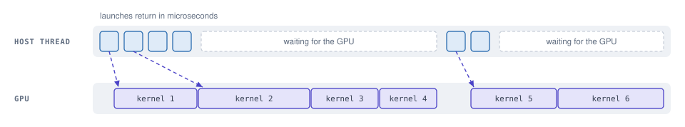
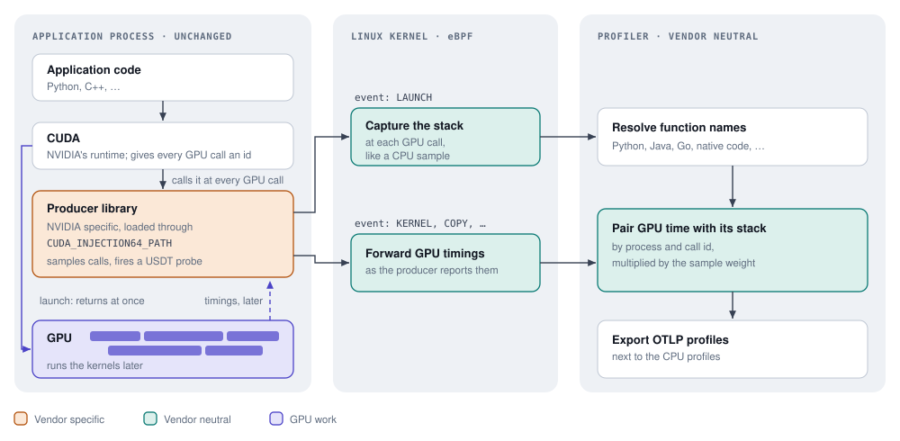
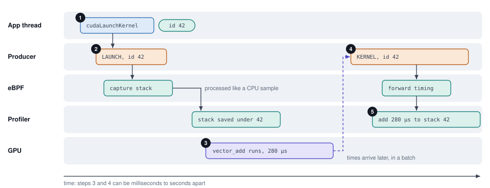
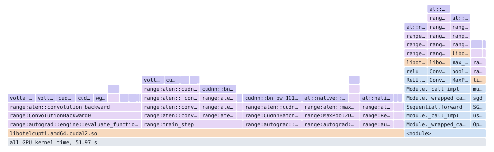

GPU Profiling
=============

# Meta

- **Author(s)**: Mattia Meleleo
- **Start Date**: 2026-11-02
- **Goal End Date**: TBD
- **Primary Reviewers**: [ebpf-profiler-maintainers](https://github.com/orgs/open-telemetry/teams/ebpf-profiler-maintainers)

# Abstract

This document proposes opt-in GPU profiling, which shows GPU time under the
stack of the code that caused it, next to CPU time. All vendor-specific code
lives in a small library that the GPU runtime loads into the application, for
example through CUDA's
[`CUDA_INJECTION64_PATH`](https://docs.nvidia.com/cupti/main/main.html#sample-cupti-trace-injection),
so applications need no change to be profiled and the profiler works the same
for every GPU vendor.

# Problem

Applications do not run code on the GPU directly. They ask the driver to start a
kernel, and the call returns right away while the kernel runs later. A CPU
profiler therefore sees the application start kernels and wait for them, but not
the GPU time those kernels take.



*A CPU profile of this thread shows six short launches and two waits. The real
cost is the GPU time below, and no stack owns it.*

In machine learning workloads most of the cost is on the GPU, so this is the
question that matters: which line of Python, or which function of a C++ service,
is responsible for the GPU time? GPU utilization metrics only say that the GPU
is busy. Vendor tools such as NVIDIA Nsight answer the question for a developer
running one program on demand, not for always-on profiling of a whole fleet.

The eBPF profiler already captures stacks in many languages, Python included,
from outside the process, and already runs on every host. What it lacks is the
GPU side: eBPF can see the application make a GPU call, but not how long the
resulting GPU work took, nor which GPU work a call caused. Only the vendor's
tracing library knows both.

# Success Criteria

- GPU time shows up under the stack of the code that caused it, in every
  language the profiler supports.
- The feature is opt-in, and its cost on the application and on the profiler
  stays bounded, also at thousands of kernels per second.
- The profiler contains no vendor-specific code.
- The profiler's existing stack capture and export are reused.

## Scope

In scope: the profiler side; the contract that a library inside the application
must follow; and reference libraries for NVIDIA (CUDA) and AMD (ROCm)\*.

Out of scope: how those libraries get loaded into applications, for example
through an environment variable or a Kubernetes webhook; and accelerators that
cannot report individual GPU calls.

\* The AMD producer builds with ROCm 7.0 and newer, but has not been tested
on AMD GPUs yet.

# Proposed Solution

## How it works

The work is split into three parts, and only the first one knows the vendor.



**A library inside the application, the producer.** Applications use NVIDIA
GPUs through CUDA, which loads the library named in the `CUDA_INJECTION64_PATH`
environment variable into every process that uses it, without any change to
the application. The producer uses CUPTI, which calls it on the application's
thread at every GPU call and later hands it the start and end time of every
finished kernel. The producer passes both on through a USDT probe: a marker
compiled into it that costs nothing until a tool attaches to it.

**An eBPF program.** The profiler attaches a small program to this probe, once
for each producer library, and Linux runs it in every process that loads the
library. When the application makes a GPU call, it captures the stack, exactly
like a CPU sample. When GPU work finishes, it forwards the producer's
description of the work.

**The profiler.** It pairs each piece of finished GPU work with the stack of
the call that started it, adds the GPU time to that stack, and exports the
result with the regular OTLP profiles. GPU profiling is opt-in: it runs once
the `gpu` probe is added to the profiler's configuration.

For example, the profiler's collector configuration turns it on:

```yaml
receivers:
  profiling:
    probes: [gpu]
extensions:
  gpu: {}
service:
  extensions: [gpu]
```

and the application, unchanged, starts with the producer:

```sh
CUDA_INJECTION64_PATH=/opt/otelgpu/libotelcupti.so python train.py
```

The pairing relies on an id that CUPTI gives every CUDA call, the call id.
Following one kernel through the system:



1. The application launches a kernel. CUPTI gives the call an id, say 42.
2. The producer fires the probe with a `LAUNCH` event for id 42, still on the
   application's thread, and the profiler captures the stack.
3. The kernel runs on the GPU. Later, CUPTI reports its start and end times,
   with id 42.
4. The producer fires the probe with a `KERNEL` event for id 42, with the
   kernel's name and how long it ran.
5. The profiler finds the stack it saved under id 42 and adds the kernel's time
   to it.

Copies between CPU and GPU memory and memory fills take the same path.

GPU timings and stacks reach the profiler in either order, because stacks go
through the same processing as CPU samples. Finished GPU work therefore waits
for its stack until the first report at least 2 seconds after it arrived; if
none arrives, the time still counts for the process, without a stack. All
kernels of a CUDA graph share one call id and land on the same stack.

After a process exits, the profiler keeps what it knows about it until the
first report at least 5 seconds later, for work still in flight. What it keeps
fits in tables of fixed size: 131,072 launches, 16,384 stacks, 4,096 processes,
and 65,536 pieces of work waiting for their stack.

## The contract between producer and profiler

The producer and the profiler are built and released separately, so they agree
on a small contract, a C header in this repository,
`probes/gpu/otel_gpu_v1_usdt.h`. Producer authors include it; applications
never see it.

The contract is a single USDT probe, `otel_gpu_v1:event`, which passes a
pointer to an event and returns nothing. An event starts with a fixed 16-byte
header, which the eBPF program reads, followed by a payload of variable size,
which only the profiler reads. The header is fixed because decoding protobuf in
eBPF is costly; the payload is protobuf so it can grow without breaking older
profilers:

```c
struct otel_gpu_event {
  uint64_t correlation_id; // the call id
  uint32_t sample_weight;  // how many calls this one stands for; 0 means 1
  uint16_t kind;           // what happened, a value of Kind below
  uint16_t payload_size;   // how many bytes of payload follow
  uint8_t  payload[4096];  // a Payload message, encoded as protobuf
};
```

```proto
// What happened. The profiler ignores events of kinds it does not know.
enum Kind {
  // The application asked the GPU to do something, such as running a kernel
  // or copying memory. Fired on the application's own thread: the profiler
  // records the thread's stack here, so it can later show which code caused
  // the work. Has no payload.
  LAUNCH = 1;

  // The next kinds report work the GPU finished for a call. The profiler adds
  // the work to the stack it recorded for that call.

  // The GPU ran a kernel, which is a function that runs on the GPU.
  KERNEL = 2;
  // The GPU copied memory.
  COPY = 3;
  // The GPU filled memory with a value.
  FILL = 4;
}

// The payload of an event. Every field is optional: a producer sets the ones
// that apply to the kind, and the profiler ignores fields it does not know.
message Payload {
  // The UUID of the GPU that did the work, such as GPU-… or MIG-… on NVIDIA.
  string gpu = 1;
  // What the work was, as the table below lists for each kind.
  string name = 2;
  // The names the application gave to the work in progress when it made the
  // call, such as "train_step", from the innermost outwards.
  repeated string ranges = 3;
  // How long the GPU worked, in nanoseconds.
  uint64 duration_ns = 4;
  // How many bytes were copied or filled.
  uint64 bytes = 5;
}
```

The `name` of an event depends on its kind. Producers of every vendor use the
same names for the same things, so that their profiles compare:

| Kind | `name` | Examples |
| --- | --- | --- |
| `KERNEL` | The kernel's name, as the compiler wrote it | `ampere_sgemm_128x64_nn` |
| `COPY` | Where the data went: H is the CPU's memory, D the GPU's, A a CUDA array | `HtoD`, `DtoH`, `DtoD`, `HtoA` |
| `FILL` | None | |

The header is little endian, as both supported architectures are. The payload
is a `Payload` message in the protobuf wire format, which a producer can write
without any library: the contract header comes with small functions that append
a string or a number. Strings travel inside the event, so a producer need not
keep them alive. A producer keeps each payload within 4 KiB, writing names last
and cutting them short, so that the other fields always fit; in PyTorch
training and ollama inference, no payload was larger than 1,700 bytes.

The profiler matches work with its call by the low 32 bits of
`correlation_id`, which must therefore not repeat within a few seconds in a
process. Each event of the work carries the sample weight of its call too, so
work whose stack never arrives still counts as often as its call stands for.

Three rules keep both sides in step:

- The producer reports nothing while no profiler is attached. Linux raises a
  counter on a USDT probe while a tool is attached to it (a
  [semaphore](https://sourceware.org/systemtap/wiki/UserSpaceProbeImplementation)),
  and the producer checks the counter of `event` on every GPU call, reporting
  nothing while it is zero. Otherwise, work started earlier would report GPU
  time without a stack.
- The header fixes the CPU register that carries the event pointer, `rax` on
  x86-64 and `x0` on arm64, so the profiler never has to work out where a
  compiler put it. The profiler refuses probes that pass it any other way. A
  producer fires the probe from a single function, since each place firing it
  is one more uprobe to attach.
- Incompatible changes ship as a new version of the contract, `otel_gpu_v2`,
  as described below.

Another vendor needs a producer library, not profiler changes: a way to load a
library into unmodified applications, and a tracing interface that calls it on
the thread making each GPU call, with an id that the later timing reports
repeat. NVIDIA provides both with CUDA and CUPTI, AMD with ROCm and
rocprofiler-sdk.

## Changing the contract

The contract carries its version in its name, so that it can change without
breaking producers or profilers already deployed.

Most changes keep the version: adding a field to the payload, since the
profiler skips fields it does not know; adding a kind, since the profiler
ignores kinds it does not know; and adding a name, such as a new copy
direction, which the profiler shows as it is. The kinds that could come next
are listed under Later in the plan.

Changing the header, or the meaning of a kind or of a field, ships as
`otel_gpu_v2`: a provider of its own, in a header whose C names differ from
v1's, so that a producer can include both. For each producer library, the
profiler attaches to the newest version that both sides know, and raises only
the `event` counter of that version; a producer that fires both reports
through the raised one, so no work is reported twice:

| Producer fires | Profiler that knows v1 | Profiler that knows v1 and v2 |
| --- | --- | --- |
| v1 | v1 | v1 |
| v1 and v2 | v1 | v2 |
| v2 | nothing | v2 |

When the two sides share no version, the profiler does not attach and the
producer's counter stays at zero: GPU data stops, and nothing wrong is
reported. The profiler keeps reading v1 as long as producers that only know it
are in use, logs once for each process that still uses it, and announces in
its release notes before it stops.

## Keeping the cost down

Capturing a stack costs a few microseconds, about as much as a CPU sample, while
training and inference jobs can launch thousands of kernels per second on one
thread. So the producer samples the calls it reports.

Each thread counts its own calls, separately for kernel launches, CUDA graph
launches and memory operations. If a thread made C calls of one
kind in the last second, and the target rate is R calls per second, each call
is reported with probability 1/N and counts N times, where N is C divided by R,
rounded down, plus one. The producer passes N as `sample_weight` in the call's
`LAUNCH` event and in the events of its work, and the profiler multiplies
the GPU time and bytes of the call by it. A thread launching 10,000 kernels a
second, for example, has about 1 launch in 51 reported, each counting 51 times.

Totals stay right on average, and the cost of stacks is capped: by default 200
calls per second per thread and kind, 20 for CUDA graph launches. A call that
is not sampled fires nothing. While the profiler is attached, CUPTI still
records every kernel and copy; the figures below include that cost.

A single run's total is off by more when fewer calls are reported: on NVIDIA
A10G and L4 GPUs, by up to 2% over a minute of PyTorch training, and by up to
12% over 10 seconds of ollama inference, whose GPU time comes from a few
hundred CUDA graph launches. Runs are compared with the exact GPU time of the
same calls, which the producer adds up when `OTEL_GPU_DEBUG_TOTALS` is set.

With these defaults on an NVIDIA A10G, PyTorch training ran 2.4% slower with
the profiler attached and 0.1% slower with the producer alone, and ollama
inference 4.4% and 1.3% slower. On an NVIDIA L4, PyTorch training ran 3.6% and
1.4% slower. On an NVIDIA T4G, an arm64 machine, it ran 1.7% slower with the
profiler attached, and the producer alone cost nothing measurable.

The profiler itself, during that training on the L4, used 0.8% more of a CPU
core with GPU profiling than without, and 123 MiB more memory at its peak. Of
that, a 16 MiB ring buffer carries GPU events, and the ring buffer of probe
stacks is as large as the one of CPU samples, which grows with the number of
CPUs: 32 MiB on this 48-CPU machine.

## What gets reported

GPU samples are added to each report next to the CPU samples. Each kind of GPU
activity is its own profile:

| Profile | Unit | Value | Stack |
| --- | --- | --- | --- |
| `gpu_launches` | count | GPU calls | the call's, with its thread |
| `gpu_kernel_time` | nanoseconds | time kernels ran | the call's |
| `gpu_mem_time` | nanoseconds | time of copies and fills | the call's |
| `gpu_mem_bytes` | bytes | bytes copied or filled | the call's |

A `gpu_launches` sample has the application's stack at the call. A sample of
GPU work starts, at the leaf, with frames the profiler adds, marked by a new
frame type, `gpu`. The first names the work, from its kind and name: the
kernel for `KERNEL`, `memcpy:` and the name for `COPY` such as `memcpy:HtoD`,
or `memset` for `FILL`; `[unknown kernel]` and `memcpy:unknown` when it has no
name. Kernel names are demangled without parameter and template lists, so that
one kernel keeps one name; a name cut short that no longer demangles is shown
as it came. Then come the application's ranges from the innermost outwards, as
`range:` frames, then the application's stack at the call, whose first frames
are those of the producer and of the vendor's runtime.

Samples of GPU work carry no thread or CPU, since GPU work runs on neither.
Instead, they carry the UUID of the GPU that did the work, as the `gpu.uuid`
attribute, so work that one process spreads over several GPUs can be told
apart, and matched with the GPU's health metrics. They are stamped with the
time of the report that holds them, not with the time the work ran.



*52 seconds of GPU kernel time of a PyTorch training job on an NVIDIA T4.
Kernels are on top, ranges below them, then the producer and the Python code
that made each call. Most frames of native libraries are hidden for
readability.*

## Compatibility

- The profiler side needs no more than the profiler already does, Linux 5.10.
- The NVIDIA producer works with CUDA 12 and 13, on amd64 and arm64, in
  processes with glibc 2.34 or newer.
- The AMD producer\* works with ROCm 7.0 or newer, on amd64.

## Security

- The profiler places its uprobe in every process that loads a library with
  the `otel_gpu_v1:event` probe, the same way it reads the memory of every
  process it profiles. A process cannot opt out other than by not loading such
  a library.
- The profiler copies each event, at most 4 KiB of payload after its header,
  and decodes the payload as protobuf, which bounds every field by the size of
  the event. A producer can only change its own process's samples.
- The producer runs inside the application, with its permissions, and needs
  no more.

## Failure modes

- When the profiler's ring buffer of GPU events is full, events are dropped
  and counted in the `bpf.errors.gpu_ringbuf_output` metric. When the ring
  buffer of probe stacks is full, the stacks of launches are dropped and
  counted in `bpf.errors.probe_ringbuf_output`, and their work is reported
  without a stack.
- Events with more than 4 KiB of payload are dropped and counted in
  `bpf.errors.gpu_event_too_large`, and events that cannot be read in
  `bpf.errors.gpu_event_read`. Events whose payload does not decode are
  dropped, and the profiler logs the first one: only a broken producer sends
  them.
- A process sends the stacks of its first GPU calls before the profiler knows
  it, when it loads a producer library the profiler is already attached to.
  Those stacks are dropped, and the work of the calls is reported without a
  stack, with its weight, as is work whose stack the profiler could not keep
  up with.
- A producer whose probe breaks the contract is refused, and the profiler logs
  why.
- When the producer cannot trace, for example because another tool holds
  CUPTI, it logs why to the application's error output and reports nothing.

## Limitations

- Each GPU vendor needs its own producer; this proposal comes with ones for
  NVIDIA and AMD\*.
- Only processes that load the producer are profiled, and the producer can only
  be loaded when a process starts.
- CUPTI serves one tool per process, the first one to ask for it, and the
  producer asks as soon as CUDA starts. Next to the producer, PyTorch's
  profiler records no GPU activity and logs why; a tool that asked before CUDA
  started keeps CUPTI, and the producer then disables itself and logs why.
- Ranges need the application to name its work, such as PyTorch under
  `emit_nvtx()`, and NVIDIA's NVTX library to be pointed at CUPTI through
  `NVTX_INJECTION64_PATH`.
- The NVIDIA producer does not report copies between GPUs, and it cuts range
  names at 127 bytes, keeping at most 64 nested ranges and 1 KiB of their
  names.

# Plan

The work lands as one pull request per item, in this order.

1. **This document.**

2. **Groundwork in the profiler.** The GPU probe needs these changes, but each
   one stands on its own:
   - `usdt`: expose the argument descriptor of each probe, such as `8@%rax`, so
     that the GPU probe can refuse producers that pass the event pointer in any
     other register.
   - `libpf`: a `gpu` frame type, for the frames that the profiler makes
     itself, such as kernel names and ranges, which belong to no language.
   - `tracer`, `reporter`: let a probe add samples that it sums up itself, such
     as GPU time per stack, to each report, with sample attributes of its own,
     such as `gpu.uuid`. Today every sample comes from a trace sent by eBPF.
     Samples of a process that exited before the report keep its metadata.
   - `tracer`: fix a crash when a probe is enabled on a running profiler.
     Enabling a probe adds its trace handlers to maps that trace handling reads
     at the same time, without a lock, which Go aborts with `concurrent map
     read and map write`. The handlers are now replaced by an updated copy
     instead of changed in place.
   - `processmanager`: attach a probe to a process only once eBPF knows the
     process's memory mappings. A probe can fire as soon as it is attached, and
     until then its stacks cannot be unwound.
   - `processmanager`: attach and detach probes under a lock of their own,
     instead of the one that trace handling takes. Attaching to a library can
     take seconds, during which no stack of any process is handled.
   - `tracer`, eBPF: send the stacks of probes, such as off-CPU and GPU,
     through a ring buffer of their own, so that a burst of them cannot crowd
     out CPU samples. The buffer takes kernel memory only when probes are
     configured.

3. **Stacks of GPU calls**, in a new package, `probes/gpu`, which is turned on
   as the `gpu` collector extension, like `offcpu`:
   - the contract header, `otel_gpu_v1_usdt.h`;
   - find the `otel_gpu_v1:event` probe in the libraries that processes load,
     and attach to it once per library, for all the processes that load it;
   - capture the stack at each `LAUNCH` event, and report it in the
     `gpu_launches` profile, multiplied by the sample weight.

4. **GPU time:**
   - eBPF: forward every other event, header and payload, through a ring
     buffer of the GPU probe's own;
   - `probes/gpu`: decode the payloads, pair `KERNEL`, `COPY` and `FILL`
     events with the stacks of step 3 by process and call id, and report
     `gpu_kernel_time`, `gpu_mem_time` and `gpu_mem_bytes`, multiplied by the
     sample weight.

5. **Named ranges:** `probes/gpu` adds the ranges of each event as `range:`
   frames, between the work and the application's stack.

6. **Reference producers**, under `tools/`: `cupti-producer` for NVIDIA and
   `rocm-producer`\* for AMD.

Later, new kinds of events could report more, each needing a producer change
and a new profile, but no new version of the contract:

- allocations and frees, per stack and kind of memory;
- unified memory moved between the CPU and the GPU, and the waits for it, per
  process;
- what kernels wait for, from the GPU's hardware sampling, per kernel;
- data exchanged between GPUs in multi-GPU training, from an NCCL plugin;
- the time of calls into libraries such as cuDNN and cuBLAS.

# Open Questions

- Should `gpu` become a value of
  [`profile.frame.type`](https://opentelemetry.io/docs/specs/semconv/registry/attributes/profile/#profile-frame-type)
  in the semantic conventions?
- Should `gpu.uuid` become a semantic convention, or reuse an existing hardware
  attribute such as `hw.id`?
- Should the profile names and units be standardized in the semantic
  conventions, and should copy directions and ranges be frame types or
  attributes instead of `memcpy:` and `range:` prefixes in frame names?
- Where should the reference producers live: in this repository under
  `tools/`, or in a repository of their own?

# Decision

TBD.

# Glossary

| Term | Meaning |
| --- | --- |
| CUDA | NVIDIA's platform for running work on its GPUs. Applications and frameworks such as PyTorch call its runtime library. |
| CUDA graph | A recorded sequence of kernels that an application replays with a single call, to save the cost of launching each one. |
| CUPTI | NVIDIA's tracing interface for CUDA. It calls a tool library at every CUDA call, and later reports when the resulting GPU work started and ended. |
| ROCm | AMD's counterpart of CUDA; rocprofiler-sdk is its tracing interface. |
| Kernel | A small program that runs on the GPU. Applications start thousands of them per second, and each runs for microseconds to milliseconds. Not to be confused with the Linux kernel. |
| MIG | A way to split one NVIDIA GPU into several smaller ones, each with its own UUID. |
| NCCL | NVIDIA's library for GPUs exchanging data in multi-GPU training. |
| Nsight | NVIDIA's profiling tools for developers. |
| NVTX range | A named region that a program marks around a piece of its code, such as `train_step`. Ranges can nest. PyTorch can mark every operation it runs, such as `aten::linear`, so the ranges active when a kernel is launched tell which part of a model it belongs to. |
